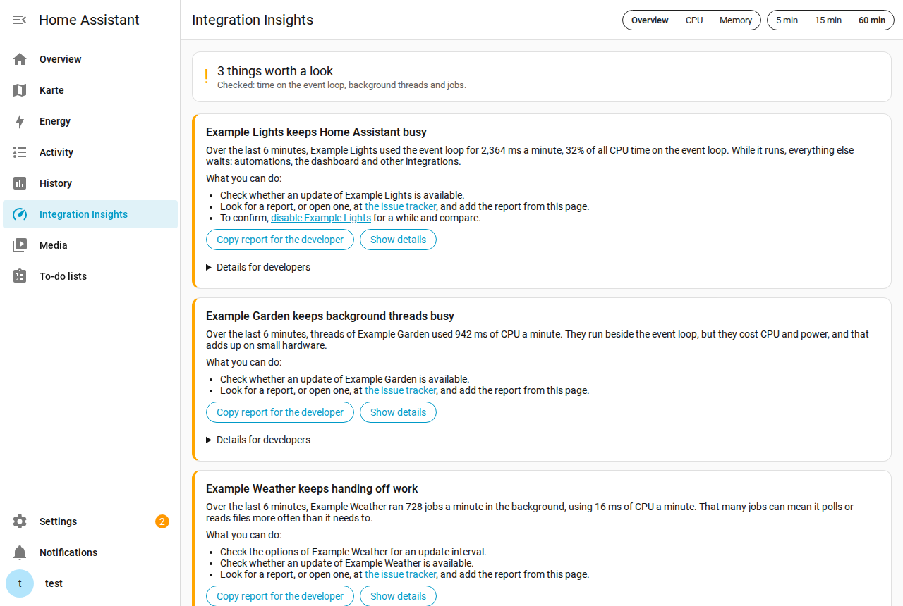

<picture>
  <source media="(prefers-color-scheme: dark)" srcset="docs/brand/dark_logo.svg">
  
</picture>

# Integration Insights

Finds the integration that slows Home Assistant down, keeps the CPU busy, or leaks memory, and tells you what to do about it.

## What it finds

- An integration that keeps the event loop busy. While it runs, automations, the dashboard and every other integration wait.
- Background threads that work around the clock, such as a file watcher that keeps polling.
- Integrations that hand a lot of work to the executor, usually polling more often than needed.
- A single callback that stopped the event loop for seconds, named by integration and function, the first time it happens.
- An integration that writes state far more often than its devices change, which wakes the recorder, the dashboard and every automation watching the entity each time.
- An event loop that often waits, usually on a blocking call.
- Listeners, timers and tasks that pile up between two memory snapshots, a sign of a leak.

Each finding says what it means and what you can do: check for an update, look at the integration's issue tracker, or disable it for a while to compare. One button copies a report to paste into an issue.

Measuring begins once Home Assistant has started, so the set-up of integrations is not counted as load. Findings start about ten minutes later. The thresholds are high on purpose: when the overview says nothing is unusual, there is nothing worth your time.

## Install

1. In HACS, add `https://github.com/RaHehl/integration-insights` as a custom repository of type Integration, and download Integration Insights.
2. Restart Home Assistant.
3. Settings > Devices & services > Add integration > Integration Insights.

A sidebar entry "Integration Insights" appears for admins.

Needs Home Assistant OS or the container image on 64-bit Linux.

## For developers

The CPU view lists every integration with its time on the event loop and in the background, for the last 5, 15 or 60 minutes. Each one opens to:

- hot spots: functions and lines, with ms per minute
- the stacks behind them, innermost first
- what triggered the work (events, timers, service calls), config entries, devices and entities
- executor jobs with their callables, and threads by name, including what a pool thread runs

"Copy as text" gives all of it in one block for an issue or a profiler session. The diagnostics download has the same numbers as JSON.

The Memory view walks the Python heap on request and splits it by integration, library and Home Assistant itself, with listeners, dispatcher connections, timers and tasks per integration. A second snapshot shows what changed.

### How it measures

- Every callback on the event loop is timed exactly, by wall clock, and charged to the integration whose config entry context it runs in, else to the module of its function or class. This sees time spent waiting, which the sampler cannot. The same code is proposed for Home Assistant's profiler integration.
- A timer on the event loop thread's CPU clock samples the stack while the loop is busy, about every 10 ms of loop CPU. When the loop is idle, it does not fire. This is what names the lines inside a callback.
- A sample goes to the integration whose code runs. Code in an entity platform base class goes to the integration that owns the entity. A library that only one loaded integration requires goes to that integration. Core and shared library code with no integration on the stack, such as aiohttp parsing a response, goes to the config entry whose context it runs in, which Home Assistant sets while an entry is set up and every task and connection started from there inherits.
- A finalizer running inside the garbage collector is charged to the owner of the object being destroyed, not to whoever allocated enough to trigger the collection.
- State writes are counted per integration in the bus event filters, with and without a change, at the cost of one dictionary update per write.
- Executor jobs are timed exactly with the worker thread's CPU clock. A job goes to the integration whose callable it runs, else to the one that submitted it. Other threads are read from `/proc` every 10 seconds. A pool thread is charged to what it runs, and for anyio to the task waiting for it.

### Cost

The panel shows its own cost under "Measuring costs". On a Raspberry Pi 3 the whole integration uses about 300 ms of CPU per minute, half a percent of one core, less on faster hardware. Timing the callbacks adds a few microseconds to each one, which lands in the callback's own time and is not shown separately. A memory snapshot takes about half a minute on a Raspberry Pi 3 and needs memory for the walk. It is refused with a reason when memory is short.

## Privacy

Reports contain code locations (file, function, line), integration domains and the IDs of config entries, devices and entities. Entity IDs can say something about your home, such as `light.bedroom`, so look before you post one. Reports contain no arguments, values, entity states or local paths. Names of entries, devices and entities only appear in the panel and in "Copy as text", not in the diagnostics download.

## Limits

- The numbers are statistical. Integrations with few samples are marked.
- Linux checks CPU timers on the scheduler tick, so very short callbacks can be undercounted.
- Time in C or Rust code is charged to the Python line that called it.
- During a long block of the event loop the sampler slows down, so the last part of such a block can land on the code that runs next.
- A blocking call uses no CPU, so the sampler cannot point at the line. The callback timing names the integration and the function that held the loop, and Home Assistant's log may name the call ("Detected blocking call").
- A memory snapshot charges an object that several integrations hold to the first one the walk reaches. Shared strings and bytes go to a shared pool.

## License

Apache-2.0
